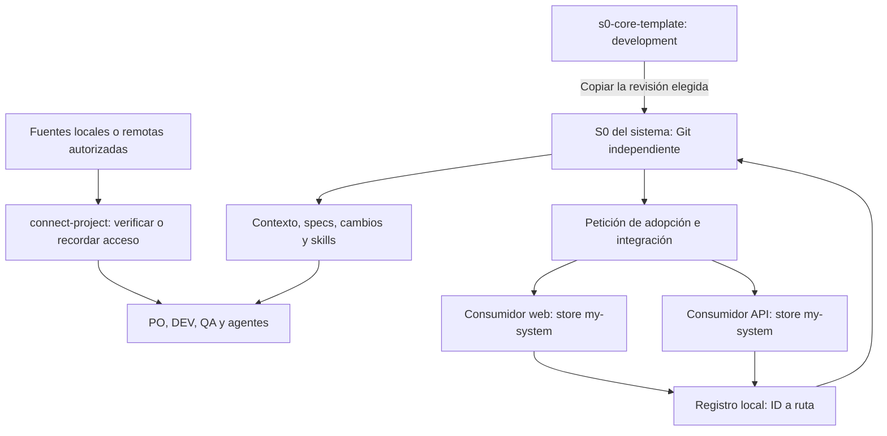

# S0 Core — resumen para compartir

Fotografía del core para una persona o IA que necesite comprenderlo y discutir
ideas sin conocer la conversación de desarrollo. Este archivo es opcional para
usar S0. Resume el diseño; las instrucciones operativas tienen sus propias fuentes.

- **Fecha de revisión:** 2026-10-28.
- **Base de revisión:** `241240f457af5e526f1f78dd66b2090f96afddd1`; esta edición
  precisa la selección de `development` al crear instancias de la plantilla personal.
  Conserva la distinción entre acceso e integración, compatibilidad por capacidades
  y seguimiento de la revisión del Core adoptada por cada instancia.
  Las comprobaciones ejecutadas se documentan por separado en `VALIDATION.md`.
- **CLI:** compatibilidad por tarea para 1.13.2 y 1.14.3; schema oficial `spec-driven`.

## Qué es y qué comparte

S0 Core es una plantilla reutilizable para crear repositorios independientes de
contexto y especificaciones. Una instancia representa un sistema y puede cubrir
uno o múltiples repositorios de código. Proporciona métodos comunes para PO, DEV
y QA, con Jira opcional y sin imponer archivos adicionales por rol.

El núcleo está formado por Markdown/YAML, workflows interpretados por un agente,
la CLI oficial OpenSpec, un verificador Python de Discovery y un verificador Node
de informes de PR. Las skills requieren
un agente con herramientas y acceso a las fuentes; no son servicios autónomos.

Cada instancia mantiene su propio historial Git, contexto, specs y cambios.
Las mejoras del maestro se incorporan selectivamente. Los nombres técnicos están
en inglés y la redacción es en español por defecto.

## Fuente común y datos de instancia

[`fdelvalle01/s0-core-template`, rama `development`](https://github.com/fdelvalle01/s0-core-template/tree/development)
mantiene métodos, workflows y comprobaciones reutilizables.
Cada instancia mantiene identidad, repositorios, organización del workspace,
contexto, planificación y políticas de su equipo. El Core no depende de un número
de componentes, un orquestador, rutas de producto ni aprobadores concretos.

`core-manifest.json` clasifica archivos compartidos, documentos que necesitan
revisión y datos propios. El comparador `scripts/compare-core.py` muestra sus
diferencias frente al maestro actual o un commit. La instancia registra la revisión
incorporada y adaptaciones justificadas en `core-adoption.json`. Las excepciones
siguen siendo visibles; ninguna herramienta copia o sincroniza automáticamente.
El [procedimiento de mantenimiento](INSTALLATION.md#core-maintenance) es la fuente
operativa de esta adopción. Una instancia utilizada para probar cambios conserva
su identidad y evidencia propia y no sustituye al maestro.

## Arquitectura



El **store** es la raíz independiente de especificaciones del S0. Su identidad
vive en `.openspec-store/store.yaml`. El registro local asocia ese ID con la ruta
del checkout. Un consumidor declara `store: <id>` y la CLI resuelve el S0 mediante
`openspec context --json`. El remoto Git comparte historial; no sustituye ese registro.

Un monorepo se conecta desde su raíz Git. Varios Git pueden apuntar al mismo S0.
Un componente puede ser un servicio, módulo o frontend y no tiene por qué coincidir
con un repositorio. Si un subsistema tiene otro S0, se referencia su fuente canónica
y sus contratos sin duplicar sus requisitos internos.

El puntero no instala las skills propias ni carga automáticamente las instrucciones
del S0 en otro cliente. El agente debe leer las fuentes de la raíz resuelta.
Cada entorno que use la CLI desde consumidores necesita sus checkouts y registro;
PO/QA pueden consultar el S0 directamente sin preparar todos los servicios.

Las fuentes remotas pueden consultarse mediante herramientas autorizadas del
cliente sin preparar un clon. Cuando se solicitan descargas, `connect-project`
obtiene copias locales mediante Git; la instalación de integraciones se pide
expresamente. El responsable elige el workspace externo;
las descargas permanecen allí, separadas del S0. Para una fuente nueva sin rama
indicada consulta la predeterminada; el resultado identifica el SHA realmente preparado.

## Mapa de archivos

Este mapa agrupa integraciones equivalentes para evitar listar cada método tres
veces. Los once nombres y sus funciones aparecen en el catálogo siguiente.

```text
s0-core-template/
├── README.md                         Entrada y elección del recorrido
├── INSTALLATION.md                   Adopción, incorporación y diagnóstico
├── PLAYBOOK.md                       Uso diario, roles y revisión humana
├── VALIDATION.md                     Comprobaciones, evidencia y pendientes
├── CORE_OVERVIEW.md                  Este resumen fechado
├── core-manifest.json                Archivos comunes, revisión y datos de instancia
├── scripts/compare-core.py           Comparador de lectura con revisión Git opcional
├── AGENTS.md                         Instrucciones comunes
├── CLAUDE.md                         Importa @AGENTS.md
├── .gitignore / .gitattributes       Exclusiones locales y finales de línea
├── .openspec-store/store.yaml        Identidad oficial; marcador inicial s0-core
├── openspec/
│   ├── config.yaml                   Schema, contexto conciso y reglas por artefacto
│   ├── specs/.gitkeep                Requisitos inicialmente vacíos
│   └── changes/archive/.gitkeep      Cambios e historial inicialmente vacíos
├── context/project.md               Página inicial que adopta cada sistema
├── repositories.yaml                Catálogo compartido, inicialmente vacío
├── .agents/skills/
│   ├── .openspec-target              Marcador de destino codex
│   ├── <skill>/SKILL.md              Cinco métodos propios y seis oficiales
│   ├── project-discovery/
│   │   ├── agents/openai.yaml        Nombre y descripción de interfaz
│   │   └── scripts/
│   │       ├── check_discovery_scope.py
│   │       └── test_project_discovery_scope.py
│   └── review-pr/
│       ├── references/report-format.md
│       └── scripts/                 Verificador de informes y sus tests Node
└── .claude/
    ├── skills/<skill>/SKILL.md       Cinco puentes propios y seis oficiales
    └── commands/opsx/               explore, propose, apply, update, sync, archive
```

Los comandos Claude son archivos `.md`. Las cinco skills propias residen completas
en `.agents/skills/`; sus entradas Claude son puentes. Los seis workflows oficiales
se generan para cada cliente con OpenSpec y no se editan manualmente. S0 no fija
proveedor o modelo; otros agentes pueden leer el contenido, pero su integración
y sus resultados requieren comprobación.

El código y sus tests ejecutables permanecen en los consumidores. La plantilla no
incluye datos de productos reales ni carpetas raíz adicionales `docs/`, `skills/`
o `tests/`. Los archivos detallados de contexto son opcionales. `repositories.yaml`
se entrega vacío y su uso es opcional: el equipo puede completar
`version: 1` y `repositories: [{id, remote, branch}]`, con `branch` opcional.
OpenSpec no lo interpreta ni clona código, concede permisos o distribuye tareas
a partir de él.

Cada integrante selecciona entradas e indica una base local o rutas por componente.
`connect-project` verifica identidad y remotos, incluidos componentes seleccionados
dentro de un coordinador Git, y recuerda sus ubicaciones fuera del contenido compartido.
Las rutas expresas prevalecen; una base indicada delimita las demás copias elegibles.
El catálogo orienta nuevas descargas, conservando ramas y cambios de clones existentes.
Una petición sólo local informa faltantes sin descargarlos. En cloud, las copias y
el acceso corresponden a ese entorno; las rutas del PC no se transfieren.

El destino de las descargas se recuerda en Git local mediante `s0.sourcesRoot`.
El índice `<workspace>/.s0-connections/<store-id>.json` registra instancia, fuentes,
ramas, rutas, SHA y estado de las copias, incluidas las anteriores. Vive fuera del
S0 y se contrasta con Git en cada uso; no sustituye las evidencias compartidas ni
el snapshot de Discovery. Esa conexión no añade scripts, dependencias o carpetas
al core.

## Los once métodos

Cada nombre corresponde a `.agents/skills/<nombre>/SKILL.md` y tiene una entrada
Claude. Las invocaciones de chat están en el playbook.

| Método | Entrada → resultado |
| --- | --- |
| `connect-project` | Fuentes seleccionadas → acceso comprobado y ubicaciones recordadas cuando se solicita; adopción e integración explícitas → identidad, registro, punteros e integraciones. Descargas, actualizaciones y Discovery se piden según la tarea |
| `project-discovery` | Fuentes autorizadas y foco → contexto trazable en borrador; escritura posterior sólo de Markdown aprobado en `context/` |
| `refine-user-story` | Necesidad, contexto y specs → alcance, criterios y dudas para PO, por defecto en conversación |
| `prepare-tests` | HDU, specs o cambio identificado → matriz de casos trazables preparados, sin ejecución por defecto |
| `review-pr` | PR o snapshot identificado y código de su revisión → hallazgos, captura e informes locales verificados; publicación sólo cuando se solicita |
| `openspec-explore` | Pregunta o problema → análisis y alternativas; capturar artefactos requiere alcance confirmado |
| `openspec-propose` | Necesidad comprendida → artefactos de planificación según schema; se detiene antes de implementar |
| `openspec-apply-change` | Cambio y repositorios autorizados → implementación, comprobaciones y avance de tareas |
| `openspec-update-change` | Plan existente y nuevas decisiones → ediciones confirmadas de planificación, sin implementar código |
| `openspec-sync-specs` | Deltas de un cambio → specs principales actualizadas; el cambio continúa activo |
| `openspec-archive-change` | Cambio a cerrar → evaluación de pendientes/sync y archivo según la opción elegida |

Una copia personal de una skill puede coexistir con la local. El cliente determina
su selección; puede pedirse leer el archivo local explícitamente. Las skills son
instrucciones, por lo que disponer de sus archivos no acredita su ejecución correcta.

## Contexto, requisitos y cambios

`context/project.md` es el índice del conocimiento del sistema: propósito, límites,
componentes y fuentes. Puede enlazar `architecture.md`, `infrastructure.md` o
`components/<name>.md` dentro de `context/` si el detalle lo justifica. El contexto
puede cubrir tecnologías, protocolos, dependencias, builds, binarios, entornos y
despliegue; no exige un documento por servicio o widget.

Discovery separa lo observado, inferencias, decisiones propuestas y desconocidos,
identificando repositorio, ruta y revisión. No convierte código encontrado en
requisitos aprobados. Las specs vigentes viven en `openspec/specs/`; una propuesta
activa no las sustituye.

En `openspec/changes/<change>/` el recorrido habitual produce `proposal.md`, deltas
en `specs/`, `design.md` y `tasks.md`, según el schema y sus condiciones. El diseño
propone decisiones para ese cambio; la arquitectura del contexto describe lo actual.
Las tareas identifican el repositorio cuando intervienen varios componentes.

## Recorridos y responsabilidades

| Situación | Recorrido |
| --- | --- |
| Sistema existente | Crear repositorio independiente y copiar la revisión de `development` → pedir adopción e integración → revisar diffs; Discovery cuando se solicita |
| Fuentes de un S0 existente | Verificar acceso local/remoto → recordar ubicaciones si se solicita; conservar consumidores |
| Sistema nuevo | Crear/clonar S0 → definir propósito sin inventar código → preparar contexto inicial → conectar consumidores cuando existan |
| Integrante de un equipo | Obtener el S0 y revisión ya preparados → leer contexto y usar las skills pertinentes; no crear otra instancia |

PO refina necesidades y criterios. DEV prepara el plan y después implementa en el
código autorizado. QA puede preparar casos en paralelo y comprobar una versión
identificada cuando disponga de suite, entorno y datos. El equipo revisa resultados
y solicita cierre o correcciones según su proceso.

Las intervenciones específicas del método son:

- Discovery presenta el contenido y sus rutas antes de pedir aprobación para escribir.
- `propose` requiere una nueva petición posterior para iniciar implementación.
- `update-change` confirma cada edición de planificación.
- `archive` confirma pendientes y ofrece opciones cuando existen deltas, incluso
  si ya están sincronizados. Puede archivarse sin sync por decisión explícita;
  un sync solicitado que falla bloquea el archivo.

Un `sync` ya solicitado no impone otra aprobación universal. Guardar refinamientos,
crear tickets o ejecutar tests requiere ese alcance. El proceso del equipo determina
revisores de PR, aceptación y publicación. Archivar no acredita QA, merge o despliegue.
Caso preparado, test implementado y test ejecutado son estados distintos.

`review-pr` contrasta el PR con código, contratos y fuentes S0 identificadas. Guarda
captura e informes bajo `.local/review-pr/`, excluido de Git, y comprueba anclas y
evidencia literal con Node.js >=20, sin dependencias npm. El verificador no acredita
procedencia, vigencia remota, cobertura ni corrección semántica. El agente comprueba
esos límites por separado; una revisión no autoriza modificar código ni publicar,
aprobar o fusionar. El método admite snapshots suministrados sin atribuirles vigencia
remota y no requiere una HDU asociada ni un subagente de un proveedor concreto.

## Requisitos y límites de la automatización

La integración y los workflows oficiales usan una CLI con las capacidades
necesarias y un agente con acceso a las fuentes. Las versiones 1.13.2 y 1.14.3 se
evalúan por tarea. La distribución npm requiere Node.js >=20.19.0; el binario
autónomo equivalente no. Discovery necesita Git y Python >=3.10 para comprobar
la escritura de contexto. Leer, refinar o preparar casos desde S0 no requiere CLI.

`connect-project` usa la CLI oficial, preserva identidad y trabajo previo, informa
conflictos y permite reejecución. Instalar herramientas requiere esa intención
en la petición; una versión compatible existente puede reutilizarse.
Descarga sólo fuentes solicitadas usando el acceso Git HTTPS/SSH disponible.
Sus cambios quedan locales: no incluye commits, push, PR ni migraciones.
La comprobación del ejecutable al iniciar una sesión está en `AGENTS.md`.

Reconectar reutiliza copias correctas sin consultar nuevas revisiones. Una
actualización explícita prepara otra copia cuando corresponde, preservando la
anterior; puede reutilizar una copia válida si la revisión no cambió. No hace pull,
reset o cambios de rama sobre copias existentes ni elimina descargas antiguas.
Informa discrepancias de rama/HEAD, acceso fallido y resultados parciales. La
preparación Git no modifica el core, schemas ni workflows oficiales de OpenSpec.

Discovery analiza archivos sin ejecutar producto, builds o tests. Captura una
referencia antes del análisis; si continúa desde `connect-project`, la captura
después de la preparación técnica. Verifica que sólo cambie el contexto aprobado.
Sin herramientas o referencia válida entrega el borrador sin escribir archivos.
El verificador compara archivos y estado Git; no prueba veracidad, aprobación
humana ni escrituras transitorias revertidas. No es un sandbox y su coste depende
del contenido de las raíces capturadas, aunque el análisis funcional sea selectivo.

El acceso remoto depende de las capacidades autorizadas del cliente; conocer
una URL no acredita acceso a sus archivos. No hay actualización automática al ejecutar `explore` o
`propose`, sincronización del contexto con el código, propagación de mejoras del
maestro ni transacciones entre Git. La implementación posterior mantiene su petición
y alcance explícitos; un inventario no autoriza editar todos sus repositorios.

## Evidencia y preguntas abiertas

Los informes históricos describen pruebas sintéticas de conexión local, repetición,
conflictos, selección de CLI y catálogo, además de tests del verificador. La matriz
canónica, sus revisiones y referencias están en [VALIDATION.md](VALIDATION.md).
Este resumen no reproduce sus cifras ni acredita nuevas ejecuciones.

La matriz distingue pruebas de operaciones Git, comprobaciones estructurales y
ejecuciones reales de agentes. Admitir múltiples repositorios no equivale a un
benchmark de escala; una prueba con remotos sintéticos no valida la autenticación
en todos los proveedores ni garantiza calidad funcional.

Para evaluar futuras mejoras quedan abiertas, sin compromiso de implementación,
la vigencia del contexto frente a varios commits y la equivalencia de comportamiento
entre agentes. La comparación de revisiones ya permite revisar una adopción selectiva;
su aplicación sigue siendo deliberada y no ofrece transacciones entre repositorios.

## Fuentes y uso de este resumen

Las reglas comunes viven en [AGENTS.md](AGENTS.md); los contratos detallados, en
los `SKILL.md`. [INSTALLATION.md](INSTALLATION.md) es la guía de preparación,
[PLAYBOOK.md](PLAYBOOK.md) reúne el uso diario y [README.md](README.md) orienta la entrada.
Ante una discrepancia, consulta esas fuentes en la revisión pertinente.

Puedes adjuntar este archivo a otra IA con la petición: «Evalúa el diseño actual,
sus supuestos, costos y alternativas. Distingue hechos, inferencias y propuestas.
Estamos explorando; identifica qué evidencia adicional necesitas».

Una copia conserva su fecha de corte. Al preparar otra exportación, contrasta
capacidades y límites con las fuentes y actualiza la revisión; no añadas reglas
operativas únicamente aquí.
