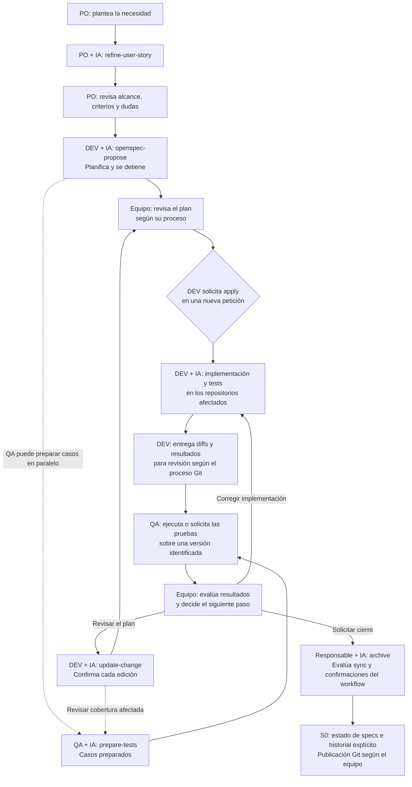

# Playbook de S0 para PO, DEV y QA

Esta guía explica el trabajo diario sobre un S0 ya preparado. Para obtenerlo o
conectar código, sigue [INSTALLATION.md](INSTALLATION.md). Los roles pueden recaer
en las mismas personas; Jira y los archivos adicionales por rol son opcionales.

La IA analiza, redacta e implementa dentro del alcance solicitado. Las personas
definen la necesidad, resuelven decisiones de negocio y revisan los resultados.
Consulta la revisión correcta: specs vigentes, propuestas y código observado
son fuentes distintas.

<a id="skills"></a>
## 1. Elegir una skill

Estas invocaciones van en el **chat del agente**, no en PowerShell. Selecciona la
entrada del repositorio o pide leer su `SKILL.md` local. Si aparece otra versión,
consulta [Skills locales](INSTALLATION.md#local-skills). Los workflows oficiales
requieren la CLI; la comprobación de versión se establece en [AGENTS.md](AGENTS.md).

| Tarea | Codex | Claude Code |
| --- | --- | --- |
| Verificar fuentes o solicitar adopción/integración | `$connect-project` | `/connect-project` |
| Descubrir contexto | `$project-discovery` | `/project-discovery` |
| Refinar una historia | `$refine-user-story` | `/refine-user-story` |
| Preparar casos QA | `$prepare-tests` | `/prepare-tests` |
| Revisar un PR | `$review-pr` | `/review-pr` |
| Explorar | `$openspec-explore` | `/opsx:explore` |
| Proponer | `$openspec-propose` | `/opsx:propose` |
| Implementar | `$openspec-apply-change` | `/opsx:apply` |
| Actualizar el plan | `$openspec-update-change` | `/opsx:update` |
| Sincronizar specs | `$openspec-sync-specs` | `/opsx:sync` |
| Archivar | `$openspec-archive-change` | `/opsx:archive` |

`sync` es un workflow del agente; no existe un comando de terminal `openspec sync`.

`connect-project` verifica código local, lectura remota o entradas seleccionadas del
[catálogo compartido](INSTALLATION.md#repository-catalog). El equipo mantiene
los remotos; cada persona indica su base local o rutas por componente, que se
verifican y se recuerdan cuando se solicita preparar las fuentes. Consultar
código no necesita instalar integraciones. Adoptar el S0 e integrar consumidores
usa el recorrido explícito de instalación; Discovery se inicia cuando se pide.
La CLI se selecciona por [capacidades](INSTALLATION.md#cli-compatibility).
Reconectar conserva las
revisiones; para obtener código remoto reciente pide una actualización explícita
según [la guía](INSTALLATION.md#connect-code). No se actualizan fuentes al abrir
`explore` o `propose`. Para implementar, identifica los repositorios y copias
autorizados; disponer de un inventario o un checkout no distribuye permisos.

## 2. Quién utiliza qué

| Rol o etapa | Qué consulta | Qué pide | Qué obtiene y dónde |
| --- | --- | --- | --- |
| PO/DEV/QA: acceso | Fuentes y referencias del sistema | Verificar o recordar fuentes con `connect-project` | Acceso comprobado y ubicaciones locales recordadas cuando se solicita |
| DEV/administrador: adopción | S0 y consumidores seleccionados | Adoptar S0 e instalar integraciones con `connect-project` | Identidad, registro, punteros e integraciones; diffs para revisión; Discovery si se pidió |
| PO | Necesidad original, contexto, specs y cambios relacionados | `refine-user-story` | Objetivo, alcance, criterios y dudas; por defecto en conversación |
| DEV: planificación | Necesidad refinada, contexto y código pertinente | `openspec-explore` cuando haga falta y `openspec-propose` | Artefactos según el schema: habitualmente propuesta, specs delta, diseño y tareas en el S0 |
| DEV: revisión del plan | Artefactos existentes y nuevas decisiones | `openspec-update-change` | Ediciones de planificación confirmadas; conserva el código |
| DEV: implementación | Cambio identificado, tareas y repositorios afectados | `openspec-apply-change` después de la propuesta, mediante nueva petición | Código y tests en los consumidores; avance y resultados según lo ejecutado |
| DEV: revisión de PR | PR o snapshot identificado, código en su SHA y fuentes S0 pertinentes | `review-pr` | Hallazgos verificables e informes en `.local/review-pr/`; publicación sólo cuando se solicite |
| QA: preparación | HDU, specs y escenarios en su revisión correcta | `prepare-tests` | Casos trazables, dudas y cobertura; por defecto en conversación |
| QA: ejecución | Casos, versión/build, suite, entorno y datos | Solicitud de implementar o ejecutar pruebas | Automatizaciones en la suite y resultados, incluidos fallos y pendientes |
| Equipo: cierre | Diffs, resultados y deltas frente a specs vigentes | `openspec-sync-specs` cuando corresponda y `openspec-archive-change` | Estado de specs según la operación elegida e historial archivado |

## 3. De una necesidad a un cambio



La revisión funcional de criterios y del plan sigue el proceso del equipo.
OpenSpec no asigna aprobadores PO/DEV/QA. La nueva petición de implementación
posterior a `propose` sí forma parte del límite de ese workflow.

QA puede preparar cobertura en paralelo. Si cambian los artefactos, revisa los
casos afectados; un cambio de intención puede requerir un cambio OpenSpec nuevo.
En multirrepositorio, cada tarea identifica su Git. Enlaza los PR de código con
el cambio S0 y registra las versiones comprobadas; no hay distribución automática
de tareas o permisos entre repositorios.

Para revisar un PR identificado puedes usar `review-pr`: captura base/head y
contrasta el código con las fuentes pertinentes. Su informe no aprueba ni fusiona
el PR y no sustituye la ejecución QA ni el cierre de OpenSpec.

## 4. Cuándo interviene una persona

| Momento | Intervención | Fuente |
| --- | --- | --- |
| Escribir contexto con Discovery | Aprobar el borrador concreto y sus archivos antes de escribir | [Project Discovery](.agents/skills/project-discovery/SKILL.md#4-publica-únicamente-el-contexto-aprobado) |
| Criterios y alcance de una HDU | PO contrasta el refinamiento y resuelve dudas de negocio | Revisión funcional recomendada por el equipo |
| Pasar de propuesta a implementación | Nueva petición explícita después de presentar el plan | [openspec-propose](.agents/skills/openspec-propose/SKILL.md) |
| Editar planificación existente | Confirmar cada edición presentada antes de escribir | [openspec-update-change](.agents/skills/openspec-update-change/SKILL.md) |
| Ambigüedad material, bloqueo o cambio de alcance | Aclarar la decisión que impide continuar | Reglas del workflow y alcance autorizado |
| Guardar refinamiento/casos o automatizar/ejecutar tests | Solicitar la acción con destino, alcance y acceso | [refine-user-story](.agents/skills/refine-user-story/SKILL.md) y [prepare-tests](.agents/skills/prepare-tests/SKILL.md) |
| Código, resultados QA, PR y merge | Aplicar revisores y criterios acordados | Proceso del equipo |
| Sincronizar y archivar | Resolver ambigüedades; confirmar pendientes y elegir el tratamiento de deltas cuando corresponda | [sync](.agents/skills/openspec-sync-specs/SKILL.md) y [archive](.agents/skills/openspec-archive-change/SKILL.md) |

Una autorización vigente no exige pedir permiso de nuevo por cada comando;
se conservan las confirmaciones específicas del método. `sync` ya solicitado no
exige otra aprobación universal. `archive` ofrece opciones cuando existen deltas,
incluso si ya están sincronizados, y pide confirmar artefactos o tareas pendientes.
Puede archivar sin sincronizar por elección expresa; si se intenta sincronizar y
falla, el archivo queda bloqueado. Sin deltas ni pendientes no hay confirmación
adicional universal.

## 5. Peticiones de ejemplo

Sustituye los corchetes. Aporta rama o revisión al consultar un cambio: `main`
puede conservar las specs anteriores mientras el cambio exista sólo en un PR.

**PO — refinar:**

```text
Lee el contexto y las specs relacionadas de este S0. Usa refine-user-story
para refinar esta necesidad: [texto]. Distingue reglas confirmadas, criterios
propuestos y dudas que tengo que resolver.
```

**DEV — preparar el plan:**

```text
Usa la skill oficial local openspec-propose para [necesidad identificada].
Consulta el contexto y el código pertinente. Identifica los repositorios
afectados y presenta los artefactos para revisión.
```

**DEV — después de recibir y revisar el plan:**

```text
Implementa el cambio [change-id] usando openspec-apply-change.
Puedes modificar [repositorios autorizados]. Ejecuta las comprobaciones
pertinentes y comunica resultados y pendientes.
```

**DEV — revisar un PR:**

```text
Usa la skill local review-pr para revisar [URL del PR].
El S0 es [ruta o store resuelto]. Cambio OpenSpec relacionado: [id, si existe].
Entrega los informes locales con hallazgos, pruebas y límites.
```

También puedes aportar un snapshot y código de la revisión si no hay acceso
remoto. Si no existe HDU/cambio vinculado, indícalo. Desde un consumidor, resuelve
el store y pide leer `.agents/skills/review-pr/SKILL.md` de esa raíz; no es necesario
copiar la skill al código. La publicación de comentarios se solicita expresamente.

**QA — preparar cobertura:**

```text
Usa prepare-tests para el cambio [change-id] en la revisión [rama o commit].
Relaciona los casos con criterios y escenarios, identifica componentes y
señala qué falta confirmar. Entrega los casos preparados, sin ejecutarlos.
```

Para automatizar o ejecutar después, indica suite, versión, entorno, datos y acceso.

## 6. Reconocer el resultado real

- **Caso preparado:** comprobación diseñada, sin evidencia de ejecución.
- **Test implementado:** código de test identificado; puede faltar ejecución.
- **Test ejecutado:** resultado sobre commit/build, entorno, datos y comando o
  enlace de ejecución. Se conservan fallos y omisiones.

Un `status` completo o una validación estructural no acreditan aceptación funcional.
Registra la versión de CLI junto a cada validación: sus diagnósticos pueden variar.
Archivar tampoco prueba aprobación QA, merge o despliegue. Al cerrar, indica el
estado de las specs, la operación realizada y la publicación Git pendiente.
Las comprobaciones de la plantilla se mantienen en [VALIDATION.md](VALIDATION.md).

Si cambian componentes, interfaces o infraestructura, revisa la vigencia del
contexto. Puedes pedir Discovery sólo sobre las partes afectadas, con borrador
y aprobación antes de guardar.
